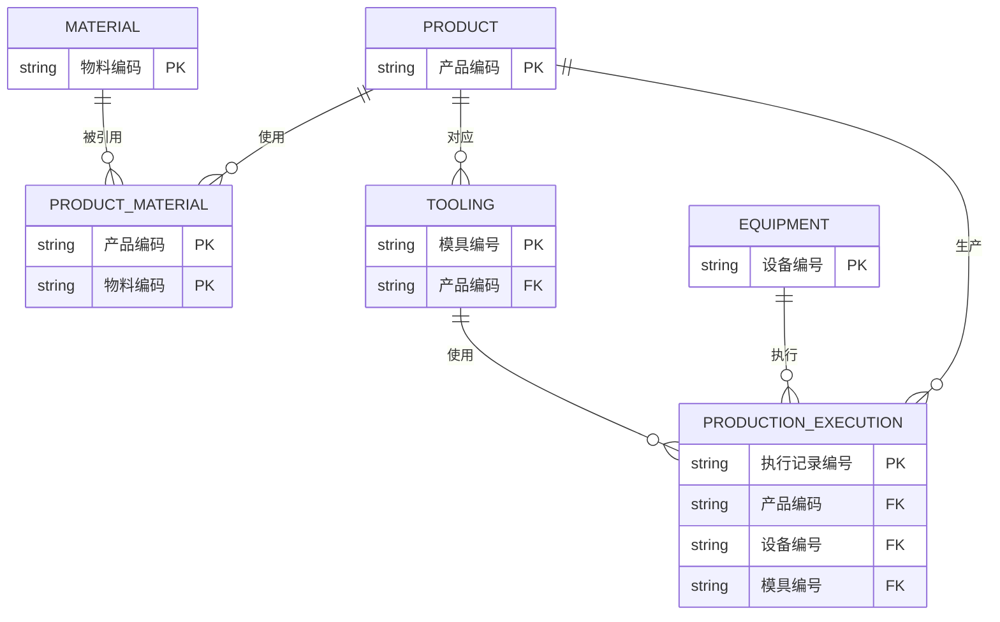

# 鑫犇电子数据模型与 ERD 总入口

> 只保留 ERD 图和主键导航；字段、流程、职责和记录由各业务域分布维护。
## ERD

## 主键入口
### 数据中心
**产品**是生产部门的主数据中心；材料、设备、模具通过关联实体或生产执行记录与产品连接。

- 产品：[[01_生产部/产品主数据]]
- 材料：[[01_生产部/材料主数据]]
- 设备：[[01_生产部/设备主数据]]
- 模具：[[01_生产部/模具主数据]]

## 进度

- [x] 生产部门 ✅ 2026-11-07
- [ ] 品质部门
- [ ] 营运部门
- [ ] 行政部门
- [ ] 财务部门
## 边界

- 各业务域维护自身字段、记录和规则。
- 本入口只维护跨域实体、主键和关系。
- 未验证关系标记为待确认。