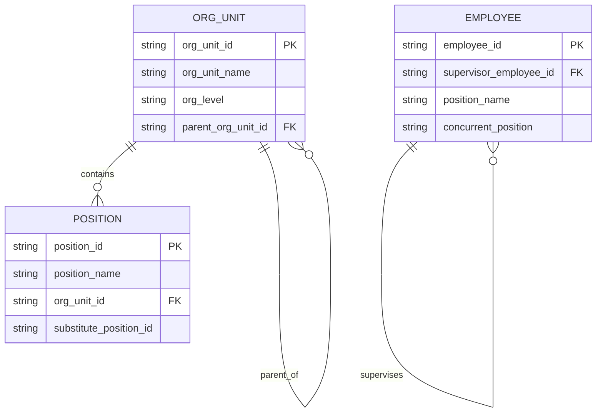

# 鑫犇电子数据模型与 ERD 总入口

> **唯一规范入口（草案）**：后续部门域 ERD、跨部门关系、关键字段字典、来源表映射及结构变更历史统一从本文件维护或链接。当前仅完成组织主数据关系核验与现有工作簿字段盘点；业务域关系仍有多项待确认，不能当作已批准的数据标准。

## 1. 目标与边界

- 统一描述业务实体、标识符、字段语义、关系、来源表和结构变更影响，避免部门各自建立互相冲突的 ERD 副本。
- **ERD 不替代业务记录**：订单、生产、库存、检验、设备、模具、人事等实际记录仍以公司指定的业务文件/系统为准。
- **ERD 不授予流程、审批、检验判定、放行、操作或数据维护权限**；责任部门和批准人须依现行组织架构、书面授权及后续确认确定。
- 文件存在或模板含有某个字段，不等于该流程已实施、该字段已有正式责任人或这些字段之间的关系已获批准。
- 个人敏感资料不复制进 ERD；跨表人员引用优先使用员工ID，字段映射和访问范围仍须由人事与管理层确认。

## 2. 证据状态

| 状态 | 含义 | 使用要求 |
|---|---|---|
| 已核实结构 | 受控工作簿中存在明确标识符/关系字段，且模板规则说明其语义 | 可记录为当前结构；仍不代表业务授权 |
| 模板字段已观察 | 字段出现在现有表头，但实际填写、唯一性或业务用途未核实 | 只能作为盘点证据；不得据此确定外键或流程关系 |
| 待确认关系 | 关系、基数、主数据权威来源、责任部门或有效规则缺证 | 暂不作为正式 ERD 关系，不据此改表 |
| 已批准规范 | 经指定责任人与管理层确认并登记依据 | 当前尚未建立此状态的审批/发布流程 |

## 3. 已核实的组织主数据关系

组织架构与职责矩阵工作簿的说明要求先维护唯一编号，并说明组织单元层级、岗位归属、员工上级关系和RACI规则。现行结构化字段包括：

- `02_组织单元`：`组织单元ID`、`组织单元名称`、`组织层级`、`上级组织单元ID`；根组织单元没有上级ID。
- `03_岗位字典`：`岗位ID`、`岗位名称`、`所属组织单元ID`、`岗位层级`、`岗位状态`等；岗位所属组织单元引用组织单元主数据。
- `01_员工名单`：`员工ID`、`上级员工ID`、`姓名`、`岗位名称`、`兼任岗位`、任职阶段和人员状态。员工表的岗位名称/兼任岗位是文本字段，并非员工—岗位ID关联表；在未确认兼岗和岗位任职模型前，不将其画成正式外键。
- 员工上级关系以`上级员工ID`表示；当前根节点使用`/`作为值。该根值编码方式尚未改为真正的空值/NULL，未经确认不得擅自改写。
- `04_RACI职责矩阵`、`05_确认清单`和`06_字段字典`作为治理记录存在；RACI当前是宽表结构，不能在未确认业务活动、角色列和人员/岗位粒度前推断其已规范化。

> 图中仅表达工作簿已经定义的组织单元父子关系、岗位所属组织单元和员工上级关系。`substitute_position_id`虽为现有岗位字典字段，但替代关系的使用规则待确认，故未绘为关系。员工的岗位文本字段也未与`POSITION`连线。

**组织结构来源**：[[02_Areas/工作经历/鑫犇电子有限公司/00_公司治理/鑫犇电子_公司组织架构与职责矩阵模板.xlsx|鑫犇电子_公司组织架构与职责矩阵模板.xlsx]]（工作表`01_员工名单`、`02_组织单元`、`03_岗位字典`、`04_RACI职责矩阵`、`05_确认清单`、`06_字段字典`）。组织名称和岗位边界以该工作簿为准；模具维修组属于生产部下属组织单元，不是独立部门。

## 4. 现有工作簿字段地图（模板盘点，不等于已批准业务模型）

> 来源路径保留现有目录名；`03_运营部/`是当前物理路径，对应正式组织单元“营运部”，本次不改目录骨架。

| 数据域 | 当前来源文件/工作表 | 已观察的标识符/字段示例 | 状态与待确认点 |
|---|---|---|---|
| 产品与图纸 | `01_生产部/生产车间/生产与物料模板.xlsx`：`产品主数据` | 产品编码、客户名称、产品型号、图号、图纸版本、材料牌号、模具编号 | 模板字段已观察；产品主数据唯一来源、产品/客户/图纸版本基数待确认 |
| 材料与批次 | 同文件：`材料主数据`、`库存与批次`、`领料核对` | 材料编码、供应商编码、材料批次、工单号、产品编码 | 模板字段已观察；材料批次的权威来源、批次/库存/领料关系待确认 |
| 生产任务 | 同文件：`生产任务` | 确认单号、工单号、产品编码、图纸版本、模具编号、设备编号 | 模板字段已观察；订单、工单、确认单之间的关联及唯一性待确认 |
| 订单与供应商 | `03_运营部/业务/订单与供应商模板.xlsx`：`客户订单台账`、`供应商管理`、`采购与来料`、`出货放行` | 订单号、评审编号、产品编码、供应商编码、材料编码、批次、检验记录编号 | 模板字段已观察；客户/订单行/评审/采购/出货关系和责任权限待确认 |
| 品质记录 | `02_品质部/质量管理与检验模板.xlsx`：客户订单评审、首件检查、过程巡检、不合格与异常、改善与审核 | 订单号、工单号、产品编码、模具编号、异常编号、检验记录编号 | 模板字段已观察；质量记录之间的关联、判定与放行边界待确认 |
| 模具与维修 | `01_生产部/模具维修组/模具与维修模板.xlsx`：模具台账、模具零件、试模记录、修机报告、模具备品 | 模具编号、产品编码、零件ID、工位号、试模编号、设备编号 | 模板字段已观察；模具/产品/版本/设备适配关系待确认。样例均不能作为真实业务事实或加工依据 |
| 设备 | `01_生产部/工程技术组/设备台账.xlsx`：设备台账 | 设备编号及设备信息字段 | 设备编号字段已观察；模具适配、吨位、安装接口等关联须经现场资料确认 |
| 人员与培训 | `04_行政部/人事/鑫犇人员主数据.xlsx`、`能力与培训模板.xlsx` | 能力与培训模板已观察到岗位ID、培训编号、员工编号、确认人ID等字段 | 人员主数据字段及其与员工ID的映射须由人事确认；ERD不复制个人敏感资料，也不定义授权 |

> 检查到的业务模板中，部分工作表为空白模板，部分含`EX-`虚拟示例。ERD只登记字段和证据状态，不把示例值、示例关系或示例流程当作真实业务记录。

## 5. 首批待建关系（只列候选，不作确认）

| 关系候选 | 当前依据 | 必须确认后才能固化的事项 |
|---|---|---|
| 客户—订单—订单评审—生产工单 | 订单台账有订单号、评审编号；生产任务有工单号 | 一对多/多对多基数、订单行标识、订单变更继承方式、责任来源 |
| 产品—图号/版本—客户要求 | 产品主数据、订单评审含相关字段 | 图纸版本唯一性、客户专属要求归属、版本生效规则 |
| 材料—供应商—材料批次—领料 | 材料、采购来料、库存批次及领料表头 | 材料主数据权威、批次编号来源、收货/库存/领料的关联键 |
| 生产工单—模具—设备—适配关系 | 生产任务含模具编号和设备编号；模具台账含设备适配字段 | 适配审批依据、模具/设备唯一编号、验证状态及记录来源 |
| 生产工单—首件/过程检验—异常/改善—出货放行 | 质量与运营模板存在相关编号字段 | 记录关联键、异常关闭与恢复条件、质量判定/出货放行职责 |
| 模具—零件—工位—试模/维修记录 | 模具维修模板含模具编号、零件ID、工位号、试模编号 | 模具结构版本、工位ID规则、维修记录关系与有效业务载体 |

### 模具编号的已知决策与治理缺口

用户已确认模具主编号采用“公司缩写 + 产品型号 + 模具套别字母”，例如`ldw1027b`；末尾字母表示同型号模具套别，不表示图纸/CAD版本，图纸版本独立记录，图纸修改不改变模具编号。该规则尚未在当前受控资料中找到正式定义及维护责任来源，故本条标为“用户已确认、受控落文待办”，在来源和责任人确认前不冒称为受控制度。

## 6. 变更对齐规则

1. 新增/删除工作表或字段，变更字段含义、标识符规则、主外键、关系基数，或改变字段来源/维护责任前，先在本入口登记变更并更新对应域 ERD。
2. 在更新业务模板前，至少确认：涉及实体与唯一标识、关系与可空/唯一规则、权威来源表/字段、责任部门/维护角色、下游引用、历史记录处理及生效日期。
3. 仅更新业务记录值、且不改变字段语义/结构/标识符的，不因此复制记录到ERD；必要时更新记录口径说明。
4. 变更未确认时保持“待确认”，不擅自改现有Excel、不新建重复台账，也不将候选关系用作操作或放行依据。
5. 获批后同步更新本入口、对应部门域图/跨部门域图链接、字段映射和变更记录；保留旧版历史，不留下竞争性“最新版”副本。

## 7. 待确认治理事项

- ERD维护责任人、跨部门数据责任人、技术编辑人和最终批准人。
- 版本/状态命名、评审和发布方式；当前`0.1`仅为基线草案，不是批准版。
- 各业务文件中主数据的唯一来源，以及业务表与记录的正式归档位置。
- 客户、产品/图纸版本、材料/批次、供应商、设备、模具、订单/工单、检验/异常和出货等实体的标识符、关系及字段定义。
- 员工岗位任职、兼岗、岗位替代与RACI的规范化表达及访问边界。

## 8. 来源与变更记录

| 版本 | 日期 | 变更 | 状态 |
|---|---|---|---|
| 0.1 | 2026-10-30 | 建立唯一ERD入口；核实组织主数据关系；盘点现有部门模板字段；未修改任何业务Excel，业务关系仍待确认 | 基线草案，待治理责任与发布规则确认 |
